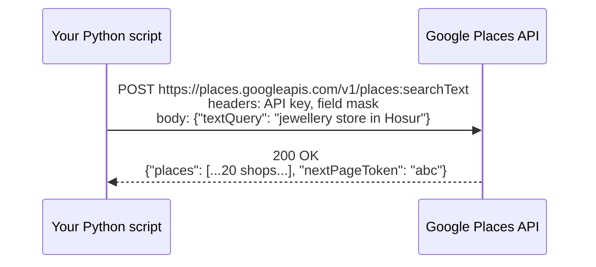
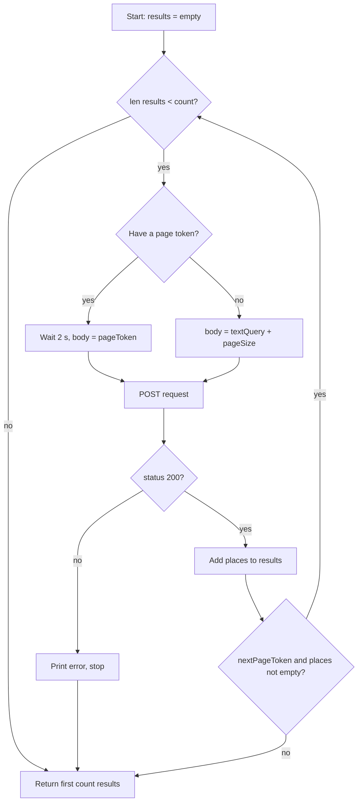
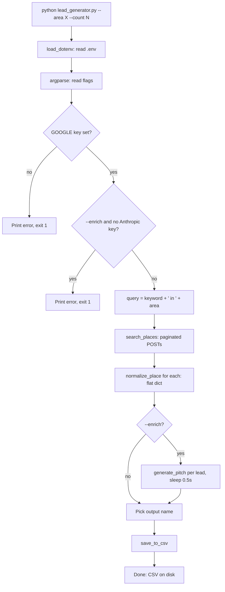
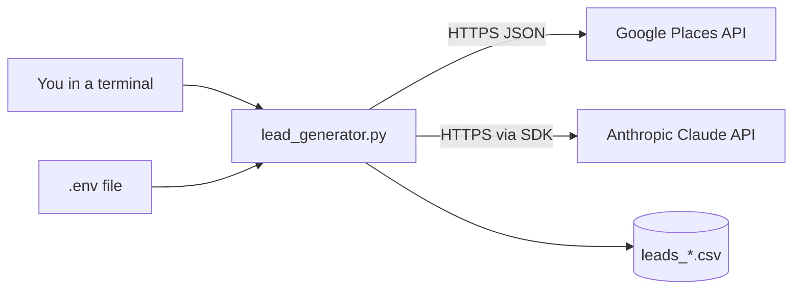

# zextractor: the complete guide

For someone who knows **HTML, CSS, JavaScript and Python**. Good news: this whole project is Python,
so you already know the language. What is new is **how programs talk to web APIs**. This guide teaches that
from zero, explains every line, and shows you how to rebuild and extend the tool.

---

## Table of contents

1. [The project in one minute](#1-the-project-in-one-minute)
2. [New ideas explained from zero](#2-new-ideas-explained-from-zero)
3. [How the program flows](#3-how-the-program-flows)
4. [Line-by-line walkthrough](#4-line-by-line-walkthrough)
5. [Files in the repo](#5-files-in-the-repo)
6. [Decisions and why](#6-decisions-and-why)
7. [Honest weaknesses and fixes](#7-honest-weaknesses-and-fixes)
8. [Build it yourself from scratch](#8-build-it-yourself-from-scratch)
9. [Change requests you might get](#9-change-requests-you-might-get)
10. [Interview and recruiter questions](#10-interview-and-recruiter-questions)
11. [Glossary](#11-glossary)
12. [Self-check exercises](#12-self-check-exercises)

---

## 1. The project in one minute

**Problem:** A small brand (rosewood and silver gifting) wanted to sell to jewellery shops. Finding shops,
addresses and phone numbers by hand on Google Maps is slow.

**Solution:** A command-line tool. You type:

```bash
python lead_generator.py --area "Hosur, Tamil Nadu" --count 25
```

It asks Google Maps for "jewellery store in Hosur, Tamil Nadu", collects up to 25 shops, and saves
`leads_Hosur_Tamil_Nadu.csv` with name, address, phone and website. Add `--enrich` and it also asks Claude (an AI model)
to write a friendly two-sentence opening line for each shop.

**Elevator pitch:**

> "A Python CLI that automates B2B lead generation. It calls the Google Places Text Search API with pagination,
> normalises the results into a CSV, and can optionally enrich each lead with an LLM-generated outreach line.
> API keys are loaded from a `.env` file, never hard-coded."

**Business words to know:** a *lead* is a possible customer. *B2B* means business-to-business (selling to shops, not to the public).
*Enrichment* means adding extra useful data to each lead.

---

## 2. New ideas explained from zero

### 2.1 What is an API?

An **API** (Application Programming Interface) is a door into someone else's program. Google Maps has a website for humans and an API for programs.
Instead of clicking, your code sends a structured **HTTP request** and gets structured **JSON** back.

You already know HTTP from HTML: when a browser loads a page it sends `GET /page`. When a form submits, it sends `POST`.
APIs use exactly the same HTTP, just with JSON instead of HTML.



### 2.2 HTTP request parts

| Part | Example here | Meaning |
|------|--------------|---------|
| Method | `POST` | What kind of action |
| URL | `https://places.googleapis.com/v1/places:searchText` | Where |
| Headers | `X-Goog-Api-Key: ...` | Extra info: who you are, what format |
| Body | `{"textQuery": "...", "pageSize": 20}` | The data you send |
| Status code | `200`, `400`, `403`, `429` | Result: OK, bad request, forbidden, too many requests |

### 2.3 JSON and Python dictionaries

JSON looks almost exactly like a Python dict. `resp.json()` turns the response text into a dict.

```python
data = {"places": [{"displayName": {"text": "Sri Jewellers"}, "formattedAddress": "MG Road, Hosur"}]}
data["places"][0]["displayName"]["text"]   # "Sri Jewellers"
```

The code uses `.get("key", default)` instead of `["key"]` because a shop might not have a phone. `.get` returns the
default instead of crashing with `KeyError`.

### 2.4 The `requests` library

The most popular Python library for HTTP. `requests.post(url, headers=..., json=..., timeout=30)` sends a POST.
`json=body` converts your dict to JSON and sets the content type. `timeout=30` means "give up after 30 seconds" so the script never hangs forever.

### 2.5 API keys and `.env` files

Google needs to know who is calling (for billing and limits), so you send a secret **API key**.
**Secrets must never be in code or Git**: bots scan GitHub for keys within minutes and can run up a bill on your account.

The pattern used:

1. Put secrets in a file called `.env`: `GOOGLE_MAPS_API_KEY=AIza...`
2. Add `.env` to `.gitignore` so Git never uploads it.
3. Commit a safe template, `.env.example`, with fake values.
4. In code, `load_dotenv()` (from `python-dotenv`) reads `.env` into environment variables, and `os.getenv("NAME")` reads them.

Environment variables are key-value settings the operating system gives every program. `.env` is just a convenient way to set them.

### 2.6 Field masks

Google's new Places API makes you list exactly which fields you want, in the `X-Goog-FieldMask` header. Why?
Less data is faster, and Google **charges by the fields you request** (contact fields like phone cost more). The code asks for:
`displayName, formattedAddress, nationalPhoneNumber, internationalPhoneNumber, id, websiteUri` and `nextPageToken`.

### 2.7 Pagination

Google returns at most 20 places per response. If there are more, it sends a `nextPageToken`. To get the next 20, you call again
with `{"pageToken": token}`. This is **pagination**, the same idea as "page 2" on a search site. Google stops at about 60 results per query.



### 2.8 Command-line arguments with `argparse`

`argparse` is in the Python standard library. It turns `--area "Mysuru" --count 50` into `args.area == "Mysuru"` and `args.count == 50`,
checks types (`type=int`), applies defaults, and creates `--help` automatically. Try `python lead_generator.py --help`.

`action="store_true"` makes a flag with no value: if you write `--enrich`, `args.enrich` is `True`; otherwise `False`.

### 2.9 CSV files

CSV (comma-separated values) is a plain-text table that Excel and Google Sheets open. `csv.DictWriter` writes a dict per row,
using `fieldnames` as the column order. `newline=""` stops blank lines on Windows. `encoding="utf-8"` keeps Tamil, Kannada or Hindi shop names correct.

### 2.10 LLM APIs (Claude)

An **LLM** (large language model) is an AI that writes text. Anthropic's Python SDK (`anthropic` package) wraps its HTTP API:

```python
client = anthropic.Anthropic(api_key=api_key)
message = client.messages.create(model="...", max_tokens=150,
                                 messages=[{"role": "user", "content": prompt}])
text = message.content[0].text
```

- `model`: which AI model to use.
- `max_tokens`: the upper limit on reply length (a token is about 3/4 of a word). It also limits cost.
- `messages`: the conversation. Here, one user message with the prompt.

The prompt is built with an f-string so each shop gets a personalised line. This is called **prompt engineering**: writing clear
instructions (who we are, what we want, tone, length).

### 2.11 Rate limiting and `time.sleep`

APIs limit how fast you can call them. The script sleeps 2 seconds before using a page token (Google needs that time) and 0.5 seconds
between Claude calls to be polite and avoid `429 Too Many Requests`.

---

## 3. How the program flows



**Architecture in one picture:**



---

## 4. Line-by-line walkthrough

### Imports and setup

```python
import os, sys, csv, time, argparse          # all standard library
from typing import List, Dict, Optional       # type hints only, no runtime effect
import requests                               # third-party: HTTP
from dotenv import load_dotenv                # third-party: .env loader
load_dotenv()
GOOGLE_MAPS_API_KEY = os.getenv("GOOGLE_MAPS_API_KEY")   # None if missing
```

The `#!/usr/bin/env python3` first line is a **shebang**: on Linux/Mac you can run `./lead_generator.py` directly after `chmod +x`.

The triple-quoted text at the top is a **module docstring**: documentation that `help()` can show.

### `search_places(query, count, api_key)`

- Builds headers with the key and field mask.
- First body: `{"textQuery": query, "pageSize": min(20, max(1, count))}`. The `min/max` keeps page size between 1 and 20 (Google's allowed range).
- Loops while it has fewer results than needed. On later pages it switches to `{"textQuery": query, "pageToken": token}` and sleeps 2 seconds.
- On a non-200 status it prints the first 300 characters of the error to `stderr` and stops (returns what it has).
- Returns `results[:count]`, a slice, so you never get more than you asked for.

### `normalize_place(place, area)`

Google's JSON is nested (`displayName.text`). This function **flattens** it into the exact shape the CSV needs.
Phone falls back from national to international to empty string using `or`. This is the **adapter** idea: convert external data into your own format at one place.

### `generate_pitch(shop_name, address, api_key)`

- `import anthropic` is inside the function, so people who never use `--enrich` do not need the package to start the script (a **lazy import**).
- Everything is wrapped in `try/except Exception`. If one call fails, it prints a warning and returns `""` so the other shops still get saved.

### `save_to_csv(leads, output_path)`

Writes header and rows. Uses `with open(...)` so the file is closed even if something fails.

### `main()`

Parses flags, validates keys (exits with code 1 on error, which tells shells and scripts "this failed"), runs the pipeline, picks a default file name:
`"Hosur, Tamil Nadu"` becomes `leads_Hosur_Tamil_Nadu.csv` (spaces to underscores, commas removed).

### `if __name__ == "__main__": main()`

Runs `main()` only when the file is executed directly, not when it is imported (for example by a test). Standard Python practice.

---

## 5. Files in the repo

| File | Purpose |
|------|---------|
| `lead_generator.py` | The program |
| `requirements.txt` | Dependencies for `pip install -r`. `>=` means "this version or newer" |
| `README.md` | Usage for users |
| `.zip` and `.zip (2)/` | An older uploaded copy of the same files (including `.env.example` and `.gitignore`). These should be cleaned up: move `.env.example` and `.gitignore` to the root, then delete both |
| `AGENTS.md` | Rules for AI coding tools |
| `GUIDE.md` | This guide |

---

## 6. Decisions and why

| Decision | Why | Trade-off |
|----------|-----|-----------|
| Official Places API, not scraping Google Maps HTML | Legal (scraping breaks Google's terms), stable JSON, reliable | Costs money after the free credit; needs a key |
| Places API **(New)** with field masks | Current API; you pay only for fields you ask for | Slightly more setup (enable the right API) |
| CLI, not a website | Fastest to build; the user is one person | Not friendly for non-technical users |
| CSV output | Opens in Excel/Sheets, no database needed | No de-duplication or history |
| One file | Easy to read and share | Harder to test and grow |
| Claude enrichment optional | Core works free of AI costs | Extra key and cost when used |
| Continue on errors | One bad shop should not lose the whole batch | Silent gaps; you must read warnings |

---

## 7. Honest weaknesses and fixes

1. **No `.gitignore` at the root**, even though the README says `.env` is ignored. *Fix:* create `.gitignore` with `.env`, `venv/`, `__pycache__/`, `*.csv`.
2. **Leftover `.zip` files** in the repo. *Fix:* move what is useful, `git rm` the rest.
3. **Max ~60 results per query.** *Fix:* loop over smaller areas (taluks) and merge.
4. **Duplicates across runs.** *Fix:* keep a `set` of phone numbers or place ids and skip repeats.
5. **No retries.** A temporary `500` or `429` stops the search. *Fix:* retry with exponential backoff (wait 1, 2, 4 seconds).
6. **Hard-coded brand text in the prompt.** *Fix:* add `--brand` and `--pitch-template` flags.
7. **Model name hard-coded.** *Fix:* read it from an env var with a default.
8. **No tests.** *Fix:* test `normalize_place` with sample dicts and mock `requests.post` for `search_places`.

---

## 8. Build it yourself from scratch

Do it in small steps. Run after each step.

1. **Folder and venv:** `mkdir leads && cd leads && python3 -m venv venv && source venv/bin/activate && pip install requests python-dotenv`.
2. **Get a key:** Google Cloud Console > new project > enable "Places API (New)" > Credentials > create API key. Restrict it to the Places API.
3. **Hello API:** a 10-line script that POSTs one query and prints `resp.json()`. Look at the shape of the data.
4. **Extract fields:** loop over `places` and print name and address.
5. **Field mask:** add the header and see how the response shrinks.
6. **Pagination:** add the `while` loop with `nextPageToken`.
7. **CSV:** write the rows with `csv.DictWriter`.
8. **argparse:** replace hard-coded values with flags.
9. **`.env`:** move the key out of the code. Create `.gitignore` *before* your first commit.
10. **Enrichment:** `pip install anthropic`, add `generate_pitch`, add `--enrich`.
11. **Commit** after each step with a clear message.

Expected time: one weekend.

---

## 9. Change requests you might get

### "Remove duplicate shops."

```python
seen, unique = set(), []
for p in raw_places:
    if p.get("id") not in seen:
        seen.add(p.get("id")); unique.append(p)
```

### "Append to an existing CSV instead of overwriting."

Add `--append`. Open with mode `"a"` and only write the header if the file does not exist (`os.path.exists`).

### "Search many areas at once."

Add `--areas-file areas.txt`. Read one area per line and run the search for each, collecting all leads into one list.

### "Retry when Google fails."

```python
for attempt in range(3):
    resp = requests.post(...)
    if resp.status_code not in (429, 500, 503): break
    time.sleep(2 ** attempt)
```

### "Save to Google Sheets."

Use the `gspread` library with a service account. Replace `save_to_csv` with a function that appends rows to a sheet.

### "Use a free AI instead of Claude."

The pitch is isolated in `generate_pitch`. Swap the body for another provider's SDK or HTTP call. Nothing else changes.
This is why one-job-per-function design matters.

### "Add ratings."

Add `places.rating,places.userRatingCount` to the field mask, add both to `normalize_place` and to `fieldnames`.

---

## 10. Interview and recruiter questions

**Q: Why use the API and not scrape Google Maps?** Scraping breaks Google's terms, is fragile (HTML changes), and can get your IP blocked. The API is official, stable and returns clean JSON.

**Q: How do you keep the API key safe?** It lives in `.env`, loaded with `python-dotenv`, and `.env` is git-ignored. A `.env.example` documents the needed variables. I would also restrict the key in Google Cloud to the Places API only.

**Q: Explain pagination here.** Google returns 20 results per page plus a `nextPageToken`. I loop, sending the token back, until I have enough results or there is no token. Google needs a short delay before a token is valid, so I sleep 2 seconds.

**Q: What is a field mask and why does it matter?** It tells Google which fields to return. It reduces response size and cost, because Places bills by field tier.

**Q: What happens if one Claude call fails?** It is caught, a warning goes to stderr, and that lead gets an empty pitch. The batch continues.

**Q: Why print errors to `stderr`?** So normal output (stdout) can be piped or saved separately from errors.

**Q: How would you test this without spending money?** Mock `requests.post` with `unittest.mock` to return fake JSON, and unit-test `normalize_place` and the file naming.

**Q: How would you scale to a whole state?** Loop over a list of taluks, add de-duplication by place id, add retries with backoff, and write to a database or Sheet instead of a CSV.

**Q: What does `if __name__ == "__main__"` do?** Runs `main()` only when executed directly, so the functions can be imported in tests without running the CLI.

**Q: Ethics / privacy?** These are public business listings, used for one-to-one outreach. I would still respect "do not contact" requests and not resell the data.

---

## 11. Glossary

| Word | Meaning |
|------|---------|
| API | A way for programs to talk to another service |
| API key | Secret password that identifies your account to an API |
| CLI | Command-line interface: a program you run in a terminal |
| CSV | Comma-separated values, a plain-text table |
| Endpoint | One URL of an API |
| Enrichment | Adding extra info to each record |
| Environment variable | A setting given to a program by the OS |
| Field mask | List of fields you want an API to return |
| Header | Extra key-value info on an HTTP request |
| JSON | Text format for data, like Python dicts |
| Lead | A potential customer |
| LLM | Large language model, an AI that writes text |
| Pagination | Getting results page by page |
| Rate limit | Max number of calls allowed per time |
| SDK | A library that wraps an API for a language |
| Token (LLM) | A small chunk of text, used to measure length and cost |

---

## 12. Self-check exercises

1. Draw the pagination loop from memory.
2. What happens if you run without a `.env`? Try it.
3. Add a `--min-rating` flag that skips shops below a rating.
4. Write a pytest test for `normalize_place` with a place that has no phone.
5. Add `.gitignore` and remove the `.zip` leftovers in a clean commit.

---

## Talking about AI-assisted work

> "I used AI tools to help write parts of this, and I reviewed every line. I can explain the pagination,
> the field mask, how the keys are protected and why errors don't stop the batch."

- Say "AI-assisted" honestly, then prove understanding by explaining or changing code live.
- Name the weaknesses in section 7 yourself.
- Practise section 9 by hand, without AI, until each change takes you under 15 minutes.
